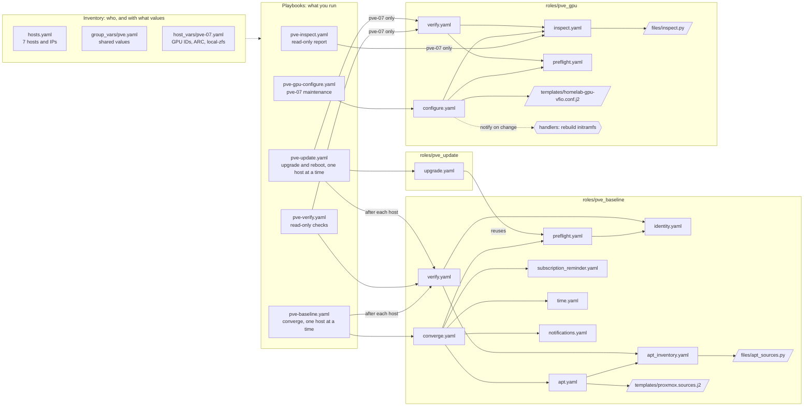

# Ansible structure

How the inventory, playbooks and roles in `ansible/` fit together.

## Reading the diagram

Solid arrows mean "runs". The dashed arrow from the inventory means every playbook reads its variables from there. The dashed arrow to the handler means it runs only when a task reports a change.

- **Inventory** says which hosts exist and holds their values. `group_vars/pve.yaml` applies to every host; `host_vars/<host>.yaml` overrides or adds values for one host. Role `defaults/main.yaml` files hold the lowest-priority values and are not drawn.
- **Playbooks** are what you run. Each one picks a role's entry task file with `tasks_from`.
- **Roles** group the work. Entry task files such as `converge.yaml` pull in smaller task files. Those use the role's `files/` (scripts piped to the host's Python, never installed) and `templates/` (files rendered with inventory values).
- **Shared checks.** `pve_baseline/verify.yaml` is the acceptance check for every host. `pve-verify.yaml` runs it on demand, and `pve-baseline.yaml` and `pve-update.yaml` run it after each host before moving on. `pve_update` reuses the baseline preflight, so updates require the same identity and full-quorum checks as configuration changes.

Only `pve-baseline.yaml`, `pve-update.yaml` and `pve-gpu-configure.yaml` change hosts. The last two also require a confirmation variable for a real run.
